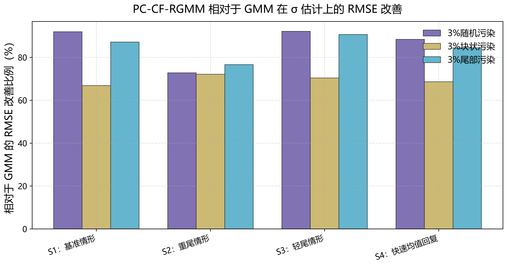
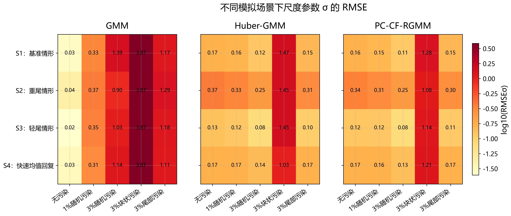
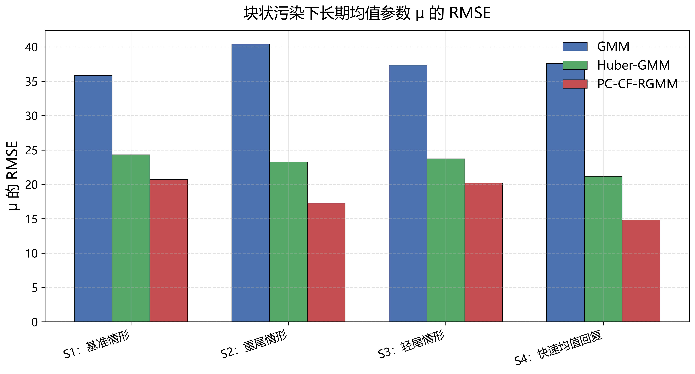

# PC-CF-IARGMM: SDE 参数估计研究复现仓库

> 修正特征函数迭代鲁棒 GMM（Principal-Component Characteristic Function Iterative Augmented Robust GMM）在 Levy 驱动 Ornstein--Uhlenbeck 模型参数估计中的完整复现实验。

## 项目简介

随机微分方程（SDE）的参数估计是量化金融和物理建模中的核心问题。经典 GMM 在数据存在污染（异常值、跳跃尾部）时估计偏差大。本仓库实现并对比了三种估计方法：

| 方法 | 说明 | 对污染数据鲁棒 |
|------|------|:--------------:|
| **GMM** | 标准广义矩方法 | ❌ |
| **Huber-GMM** | Huber 损失加权的鲁棒 GMM | ✅ 部分 |
| **PC-CF-RGMM** | 本工作：主成分修正特征函数 + 迭代增强 | ✅ 强 |

**模型**：Classical Tempered Stable Levy 驱动的连续 OU 过程

$$dX_t = -\kappa (X_t - \mu) dt + \sigma dL_t, \quad L_t \sim \text{CTS}(\alpha, \lambda)$$

## 仓库内容

- **数值模拟**（4 场景 × 5 污染等级 × 200 次重复 × 3 方法）
  - S1 Baseline / S2 重尾 / S3 轻尾 / S4 高均值回复
  - 污染：C0 干净 / C1 随机 1% / C2 随机 3% / C3 块状 / C4 尾部
- **实证分析**：VIX 波动率指数 2000–2024 日度数据

## 快速开始

### 方式一：Docker（推荐）

```bash
docker build -t sde-gmm .
docker run --rm -v $(pwd)/output:/app/src/results_stage3_final sde-gmm
```

### 方式二：本地 Python

```bash
pip install -r requirements.txt

# 跑数值模拟（完整实验，约 30–60 分钟）
cd src
python pc-cf-iargmm-数值模拟_stage3_final.py

# 跑 VIX 实证（约 5 分钟）
python pc-cf-iargmm-VIX数据_stage3_FINAL.py
```

## 核心结果（精选）

**PC-CF-RGMM 相比标准 GMM 在 3% 随机污染下的 sigma 参数 RMSE 改善**：



**sigma 参数 RMSE 热力图（越蓝越好）**：



**mu 参数四种场景 × 五种污染等级下的 RMSE 对比**：



## 项目结构

```
SDE-GMM-Estimation/
├── README.md
├── requirements.txt
├── Dockerfile
├── .gitignore
├── src/                              # 核心脚本
│   ├── pc-cf-iargmm-数值模拟_stage3_final.py
│   └── pc-cf-iargmm-VIX数据_stage3_FINAL.py
├── data/                             # VIX 实证数据
│   └── VIX_Processed_For_TW_GMM.csv
└── figures/                          # 论文核心图（已生成）
```

## 运行产物说明

脚本运行后会在 `src/` 下生成 `results_stage3_final/` 目录，包含：
- `figures/`：所有 RMSE 热力图、箱线图、失败率图
- `tables/`：按场景/污染等级透视的 RMSE / Bias / MAE / SD 表
- `raw_results.csv`：全部 4×5×200×3 次实验的原始输出

## License

MIT
